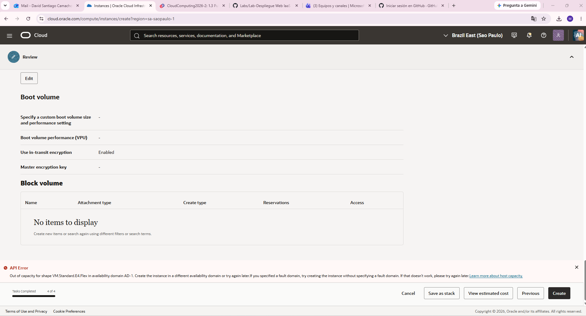
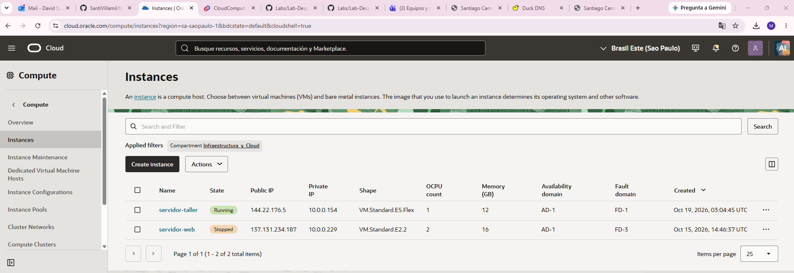
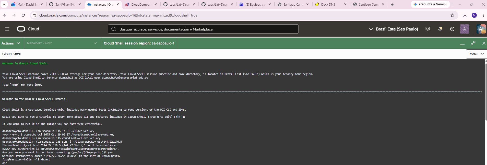
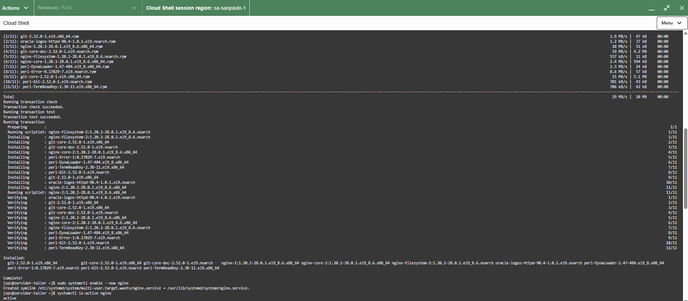
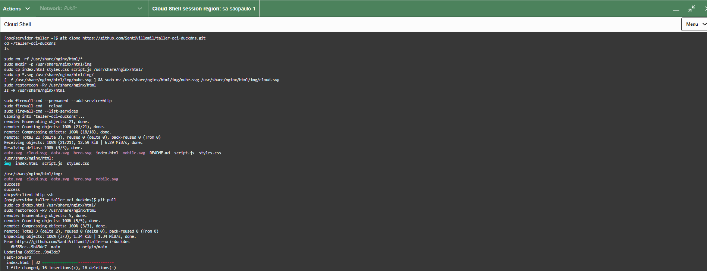
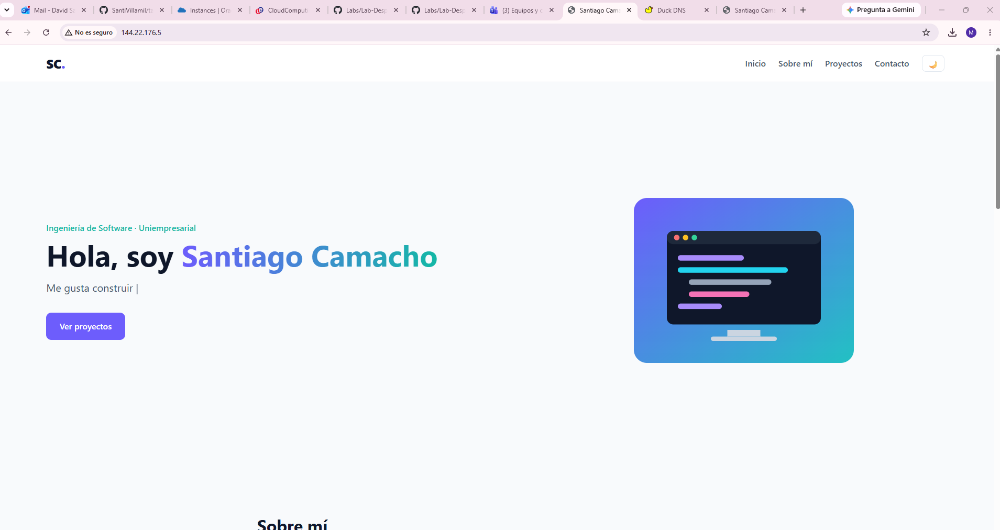
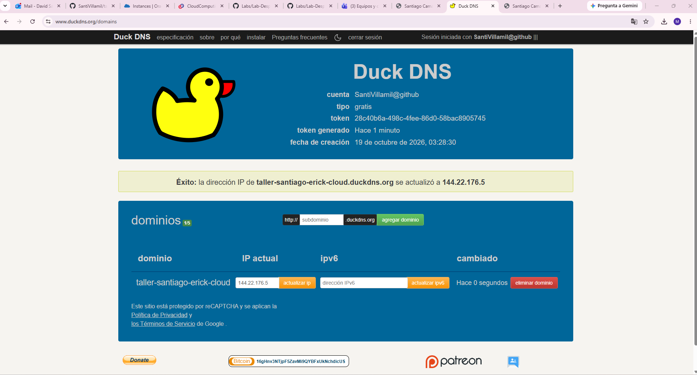
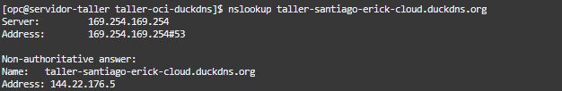
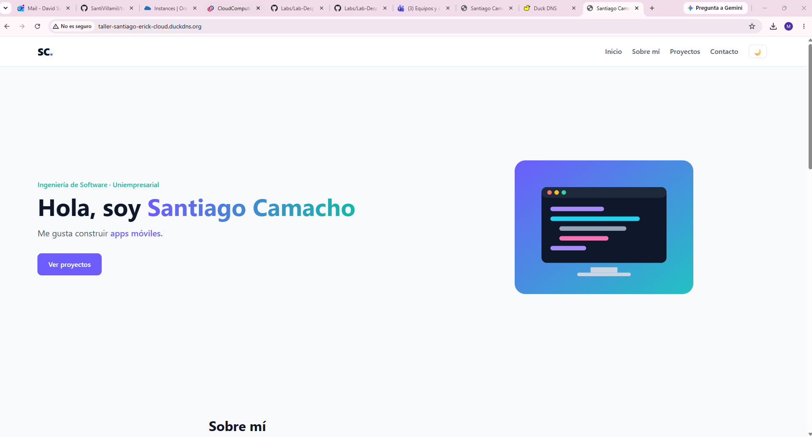
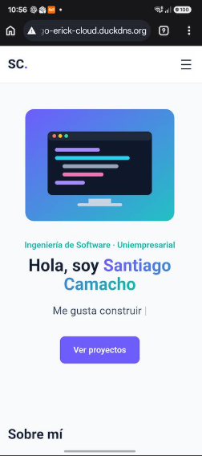

# Publicación web en OCI con Nginx y DuckDNS

**Estudiantes:** David Santiago Camacho Villamil · Erick Leandro Criollo Marulanda

**Asignatura:** Cloud Computing 2026-2 · Uniempresarial

**Sitio publicado:** http://taller-santiago-erick-cloud.duckdns.org

> Esta guía reutiliza la red creada en el Taller 1 (`red-infraestructura`, `subred-web`, puertos 22 y 80 abiertos) y crea una **máquina virtual nueva** para publicar una página web propia con Nginx y un subdominio de DuckDNS.

## Tabla de contenido

1. [Crear la nueva máquina virtual](#1-crear-la-nueva-máquina-virtual)
2. [Conectarse por SSH desde Cloud Shell](#2-conectarse-por-ssh-desde-cloud-shell)
3. [Instalar Nginx](#3-instalar-nginx)
4. [Abrir el puerto 80 en el firewall de la VM](#4-abrir-el-puerto-80-en-el-firewall-de-la-vm)
5. [Publicar la página web propia](#5-publicar-la-página-web-propia)
6. [Configurar el subdominio en DuckDNS](#6-configurar-el-subdominio-en-duckdns)
7. [Pruebas desde un navegador externo](#7-pruebas-desde-un-navegador-externo)

---

## Requisitos previos

| Recurso | Valor |
|---|---|
| Región | Brazil East (São Paulo) |
| Compartimento | `Infraestructura_y_Cloud` |
| Red virtual (VCN) | `red-infraestructura` (10.0.0.0/16) |
| Subred pública | `subred-web` (10.0.0.0/24) |
| Reglas de entrada | TCP 22 (SSH) y TCP 80 (HTTP) desde `0.0.0.0/0` |

---

## 1. Crear la nueva máquina virtual

1. En la consola de OCI abrir **Compute > Instances** y seleccionar el compartimento `Infraestructura_y_Cloud`.
2. Pulsar **Create instance** y completar:

| Campo | Valor |
|---|---|
| Name | `servidor-taller` |
| Compartment | `Infraestructura_y_Cloud` |
| Image | Oracle Linux 9 |
| Shape | `VM.Standard.E5.Flex`, 1 OCPU |
| VCN | `red-infraestructura` |
| Subnet | `subred-web` |
| Public IPv4 address | Activada |

3. En **Add SSH keys** seleccionar **Generate a key pair for me**, descargar la llave privada y renombrarla `llave-web.key`.
4. Pulsar **Create**. Con `VM.Standard.E4.Flex` la consola respondió **Out of capacity for shape VM.Standard.E4.Flex in availability domain AD-1**: la región no tenía capacidad disponible para ese tipo de máquina. Se volvió a la sección **Image and shape**, se cambió a `VM.Standard.E5.Flex` y se creó sin errores.
5. Esperar el estado **Running** y copiar la **IP pública** de la instancia: `144.22.176.5`.





---

## 2. Conectarse por SSH desde Cloud Shell

1. En la barra superior de OCI abrir **Cloud Shell** y elegir la red **Public Network**.
2. En el menú de Cloud Shell, usar **Upload** para subir `llave-web.key`.
3. Ejecutar:

```bash
chmod 600 ~/llave-web.key
ssh -i ~/llave-web.key opc@144.22.176.5
whoami
```

Escribir `yes` cuando pregunte por la huella del servidor. `whoami` debe responder `opc`.



---

## 3. Instalar Nginx

```bash
sudo dnf install -y nginx git
sudo systemctl enable --now nginx
sudo systemctl status nginx
```

El estado debe aparecer como **active (running)**. Salir del status con `q`.



---

## 4. Abrir el puerto 80 en el firewall de la VM

Además de la Security List de OCI, Oracle Linux tiene su propio firewall (`firewalld`) que bloquea HTTP.

```bash
sudo firewall-cmd --permanent --add-service=http
sudo firewall-cmd --reload
sudo firewall-cmd --list-services
```

La lista debe incluir `http`. Abrir `http://144.22.176.5` en el navegador: debe aparecer la página de prueba de Nginx.

La salida de estos comandos aparece en la captura del paso 5 (`success`, `success` y `dhcpv6-client http ssh`).

---

## 5. Publicar la página web propia

La página tiene 4 secciones (Inicio, Sobre mí, Proyectos, Contacto), imágenes SVG, CSS adaptable a móviles (`@media`) y funcionalidades en JavaScript (menú hamburguesa, modo oscuro, texto animado, contadores, filtro de proyectos y validación del formulario).

Archivos del repositorio:

| Archivo | Contenido |
|---|---|
| `index.html` | Estructura de la página |
| `styles.css` | Estilos y diseño responsive |
| `script.js` | Funcionalidades en JavaScript |
| `*.svg` | Imágenes de la página |

En la VM, clonar este repositorio y copiar la página a la carpeta que sirve Nginx (`/usr/share/nginx/html`). Las imágenes van en la subcarpeta `img/`, que es la ruta que usa `index.html`:

```bash
git clone https://github.com/SantiVillamil/taller-oci-duckdns.git
cd ~/taller-oci-duckdns
ls

sudo rm -rf /usr/share/nginx/html/*
sudo mkdir -p /usr/share/nginx/html/img
sudo cp index.html styles.css script.js /usr/share/nginx/html/
sudo cp *.svg /usr/share/nginx/html/img/
sudo restorecon -Rv /usr/share/nginx/html
ls -R /usr/share/nginx/html
```

`restorecon` aplica la etiqueta de SELinux correcta a los archivos; sin ese paso Nginx puede responder **403 Forbidden**.

Abrir `http://144.22.176.5` en el navegador.

Para publicar cambios posteriores en la página, se editan en GitHub y se actualizan en la VM:

```bash
cd ~/taller-oci-duckdns
git pull
sudo cp index.html styles.css script.js /usr/share/nginx/html/
sudo restorecon -Rv /usr/share/nginx/html
```





---

## 6. Configurar el subdominio en DuckDNS

1. Ingresar a https://www.duckdns.org e iniciar sesión con la cuenta de GitHub.
2. En **sub domain** escribir `taller-santiago-erick-cloud` y pulsar **add domain**.
3. En **current ip** escribir `144.22.176.5` y pulsar **update ip**.
4. Verificar la resolución desde Cloud Shell:

```bash
nslookup taller-santiago-erick-cloud.duckdns.org
```

La respuesta muestra `Address: 144.22.176.5`, es decir, el subdominio apunta a la máquina.





---

## 7. Pruebas desde un navegador externo

1. Abrir `http://taller-santiago-erick-cloud.duckdns.org` desde el navegador del PC.
2. Abrir la misma dirección desde un celular con datos móviles (red externa a la VM).
3. Probar las funcionalidades: menú en móvil, modo oscuro, filtro de proyectos y formulario.





---

## Resultado

| Elemento | Valor |
|---|---|
| Máquina virtual | `servidor-taller` (Oracle Linux 9, `VM.Standard.E5.Flex`) |
| IP pública | `144.22.176.5` |
| Servidor web | Nginx |
| Subdominio | http://taller-santiago-erick-cloud.duckdns.org |
| Repositorio | https://github.com/SantiVillamil/taller-oci-duckdns |
